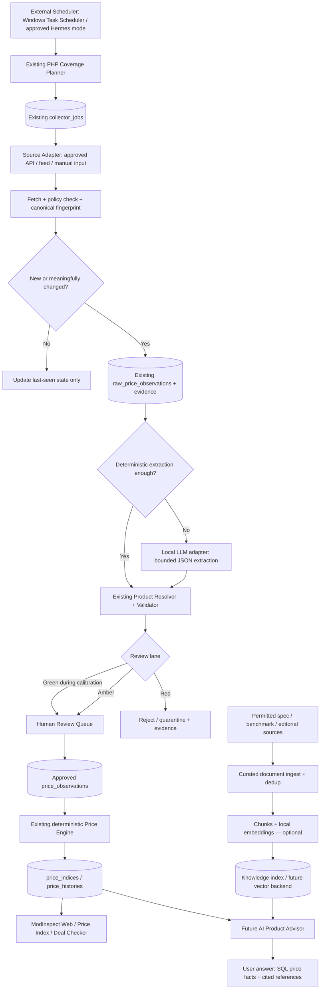

# ModInspect — Local AI Data Intelligence Pipeline (LADIP)
## Technical Design Proposal · Architecture / Data Schema / Feature Backlog / Resume Plan

| Field | Value |
|---|---|
| Document ID | `MI-TDP-LADIP-001` |
| Version | `0.1 — Draft for future implementation` |
| Created | `2026-10-13 (Asia/Bangkok)` |
| Initiative | **LADIP — Local AI Data Intelligence Pipeline** |
| Project | **ModInspect** — Thai-first used-hardware market intelligence |
| Portfolio status | **PARKED / DEFERRED — NOT CANCELLED** |
| Current owner priority | **TMGS** |
| Development authorization | **DOCUMENTATION ONLY** — no code, migrations, scheduled jobs, live crawling, paid API, or deployment approved |
| Proposed repository path | `docs/proposals/MODINSPECT_LADIP_TECHNICAL_DESIGN.md` |
| Review trigger | Owner explicitly resumes ModInspect after TMGS resources are released |

> **Intent:** Preserve an implementation-ready proposal so ModInspect can resume without re-discovering the design. This document is an **additive extension**, not a replacement for `ModInspect_Master_Blueprint_v1.1.md`, running code, actual database migrations, or existing review/pricing rules.
>
> **Document safety:** The SQL below is a **schema proposal, not an executable migration**. Do not apply it to any database until schema reconciliation, tests, and explicit owner approval.

---

## 0. Executive decision and pause policy

**Decision proposed:** Re-purpose the local RTX 3070 8GB workstation from a large, general-purpose agentic coding workload to a bounded **AI data automation worker**. Use deterministic PHP workers for collection/orchestration and a small local model for selective extraction, classification, and product matching. Use RAG for comparatively stable reference knowledge, **not** as the authoritative price store.

- **Primary price truth:** existing ModInspect MySQL/MariaDB market-observation and snapshot schema.
- **Local AI role:** optional specialized worker behind a versioned adapter; never determines market price or auto-accepts a REAL observation by itself.
- **Hermes role:** optional schedule / operations assistant; **not a mandatory dependency**. If a Hermes agent needs 64K context, the data pipeline can call a local model directly with a much smaller per-request context via an API, subject to runtime verification.
- **Scheduler role:** existing bounded PHP CLI jobs driven by an external scheduler. Windows Task Scheduler or a PHP/OS cron-compatible scheduler is a baseline fallback.
- **RAG role:** specifications, benchmark explanations, buying guides, curated documentation, and question answering with citations; SQL remains the source of live prices.
- **Owner capacity:** **No development or unattended jobs while TMGS is priority**. No GPU contention with TMGS workflows without explicit scheduling approval.
- **Cost:** preserve ModInspect's **zero external spend policy (0 THB third-party budget without approval)**. Electricity, local compute, and hosting resources are not magically free; monitor those separately.

### 0.1 What “parked” means operationally

1. This proposal can be archived, edited, and reviewed.
2. No feature work, DB mutation, implementation sprint, live provider activation, or scheduler enrollment is implied.
3. Existing ModInspect assets and branches remain intact; no reset/rebuild.
4. When returning, inspect latest repository + runtime and reconcile changed schema before accepting this document.
5. Owner explicitly authorizes each activation gate (`RESUME_REVIEW`, `POC_APPROVED`, `LIVE_SOURCE_APPROVED`, `PRODUCTION_DEPLOY_APPROVED`).

---

## 1. Alignment with the existing repository (verified as remote snapshot)

**Source reviewed:** GitHub `thuliam/modinspect`, default branch `main`, on 2026-10-13. This is a **remote repository/document snapshot**, not a claim about the newest local working tree, deployed runtime, or live DB. The latest documents inspected contain status entries dated 2026-09-13; current state must be rechecked on resume.

| Existing asset / rule | Preserve / extend |
|---|---|
| `ModInspect_Master_Blueprint_v1.1.md` | Baseline product/architecture decisions; LADIP is supplemental |
| `AGENTS.md` | Mandatory Codex project rules, source of truth, security, and zero-cost gate |
| `docs/PROJECT_STATUS.md`, `context/project_state.json` | Development handoff and status tracking (verify freshness before resuming) |
| Pure PHP 8.1+ MVC + PDO + MySQL/MariaDB | **Do not introduce a new framework by default** |
| `products`, `product_variants`, `product_aliases` | Canonical product/variant/alias truth |
| `data_sources`, `source_incidents` | Source policy, allowed method, pause/disable and incident response |
| `collector_jobs`, `collection_runs` | Existing bounded scheduling and collection status; **reuse, don't recreate** |
| `raw_price_observations`, `market_evidence`, `extraction_runs` | Immutable evidence/acquisition lineage |
| `price_observations`, `observation_review_decisions`, `review_corrections` | Staging, review, corrections; no bypass or auto-promotion |
| `price_indices`, `price_histories`, `price_snapshot_observations` | Deterministic price engine and versioned snapshot provenance |
| `articles`, `faqs` | Existing editorial/public content; can become a **permitted** knowledge source |
| `app/Services/Collection/CoveragePlanner.php` | Existing due/priority selection, not a new planner |
| `cli/coverage.php`, `cli/run_collection_jobs.php` | Existing scheduler-friendly entrypoints (mock restrictions preserved) |
| `docs/COLLECTION.md`, `docs/DATA_MODEL.md`, `docs/ARCHITECTURE.md` | Consult before any adapter/schema change |

**Important preexisting state:** The inspected `docs/PROJECT_STATUS.md` describes a `Phase 3H-R1` REAL batch review gate awaiting owner human review, and says public visual work is blocked pending meaningful reviewed REAL data. Preserve that gate. The document also describes mock runners and live-provider infrastructure, but **does not authorize live crawling, green auto-accept, or billable providers**.

### 1.1 Existing vs new — hard boundary

- **Existing and reusable:** products, aliases, job queue, source controls, candidate/evidence/extraction flow, validation lanes, human review, snapshots, pricing analytics, admin auth, audit and offline import.
- **Proposed but not yet verified as implemented:** a dedicated local inference adapter, per-inference usage telemetry, repeat-listing change tracking, opt-in RAG corpus/chunks, source freshness/diff optimization, off-host data synchronization, AI advisor.
- **Deferred until proven necessary:** semantic vector database, marketplace connectors requiring paid/billing-enabled APIs, fully autonomous crawler navigation, new public AI features.

---

## 2. Product goals and non-goals

### 2.1 Goals

- Reduce human work required to turn permitted source listings into high-quality price observations.
- Preserve listing identity, revisions and price-change events across repeated checks.
- Keep low-VRAM inference useful: small requests, bounded batches, deterministic fallbacks, and retryable jobs.
- Maintain auditable provenance: source → raw candidate → evidence → extraction → validation → review → accepted observation → snapshot.
- Support CPU and GPU first; expand only after quality gates.
- Add contextual product knowledge for future AI Product Advisor without distorting price statistics.
- Avoid interfering with TMGS while ModInspect is paused.

### 2.2 Non-goals

- No autonomous price-setting based on LLM text.
- No “put prices into RAG and query nearest vector” as the price engine.
- No scraping around paywalls, robots restrictions, authentication, CAPTCHA, rate limits, or blocks.
- No unreviewed REAL evidence into public price calculations.
- No new ERP-style orchestration platform or multi-agent framework just for crawling.
- No always-running large 35B coding model on the 3070.
- No ingestion of seller PII beyond the minimal data already permitted in ModInspect policy.

---

## 3. Target architecture



### 3.1 Runtime deployment boundaries

| Component | Preferred placement | Reason |
|---|---|---|
| Public ModInspect PHP web | Existing permitted web hosting | Normal public UI + admin API |
| App and price database | Existing approved ModInspect MySQL/MariaDB | Single price/observation system of record |
| Collector/normalizer | Local Windows worker / STUDIO or other explicitly approved machine | Bounded low-cost jobs, not public |
| Local LLM runtime | PC with RTX 3070 8GB | Small single-task inference; no public listener |
| Scheduler | External scheduled CLI call | DB queue persists even if machine is offline |
| Future RAG store | Local-first database/file index | No managed vector DB needed for POC |
| Optional remote sync | **HTTPS ingestion API**, mutually authenticated by scoped service credential | Do not directly expose home Ollama/MySQL to Internet |

**Deployment note:** Verify network topology before coding. Remote main README references a shared cloud DEV database; tests **must never mutate the shared DEV database**. A worker need not be Internet-accessible. If the local worker is allowed to access the remote API, it should initiate outbound HTTPS requests, not accept inbound webhooks on home IP.

### 3.2 Recommended resource controls

- Concurrency: **one** local LLM inference at a time at POC.
- Begin with a small quantized model in approximately the 4B class; benchmark accuracy and wall time, do not pick by parameter count alone.
- Candidate context window: **4K–8K per small extraction task**; raise only when accuracy needs it and VRAM supports it.
- Avoid blindly keeping 64K–128K KV cache allocated. The 64K Hermes agent setting is **not** a required input length for a direct model API call.
- Use JSON-only structured output + timeout + limited retry count; deterministic validator decides fate.
- On model unavailable/OOM: mark job retryable/needs review; crawler and price history must not corrupt data.
- Worker resource budget and allowed hours are configurable, disabled by default, and must account for TMGS priority.

---

## 4. Data flow: price collection is SQL-first

### 4.1 Collection lifecycle

1. **Plan** — existing Coverage Planner prioritizes products with low coverage, stale observations, or meaningful anomalies.
2. **Check source policy** — consult `data_sources.is_active`, `is_paused`, allowed method, budgets and incidents.
3. **Fetch** — use a compliant source adapter; attach source identity, timestamp, and allowed evidence.
4. **Normalize identity** — derive stable **listing identity hash** (source + source-native immutable listing ID or canonical URL identifier), stripping tracking parameters without conflating variants.
5. **Detect change** — derive a **content fingerprint** from significant listing fields (price, title, condition, warranty, availability, bundle status); do not use fetch time in fingerprint.
6. **Unchanged:** update last-seen timestamp; avoid LLM and new observation.
7. **Changed/new:** persist raw acquisition/evidence through existing lifecycle and create a **new revision** rather than overwrite history.
8. **Extract:** deterministic parser first; call local LLM only when a defined uncertainty condition is met.
9. **Resolve:** existing canonical resolver matches `products` / `product_variants` / aliases.
10. **Validate:** deterministic CPU/GPU rules, type checks, source integrity, price and listing conditions.
11. **Review:** preserve existing Green/Amber/Red semantics; **Green remains human-reviewed during calibration**.
12. **Snapshot:** only approved eligible REAL observations enter deterministic price index. Separate asking vs sold.

### 4.2 Idempotency design

**Known schema issue to evaluate, not assume fixed:** `raw_price_observations` currently has `UNIQUE(source_id, external_reference_hash)`. Before implementation inspect how `external_reference_hash` is actually constructed. If it represents only the listing identity, a later price change may be suppressed. If it includes mutable content, repeat checks may create redundant rows.

**Proposal:** distinguish:

- `listing_key_hash`: stable identity across refreshes.
- `content_hash`: meaningful revision fingerprint.
- `source_listing_states`: mutable latest state and last-seen heartbeat.
- `source_listing_versions`: append-only distinct revisions with a link to existing raw observation **where appropriate**.

Races must be resolved transactionally; use uniqueness constraints and a conditional insert/upsert. Fetch again during review if a listing changes, and mark expired or withdrawn listings appropriately.

### 4.3 JSON extraction contract (proposed `listing-extract-v1`)

Inputs are **untrusted source data**, never agent instructions. Model output is a hypothesis requiring schema + business validation.

```json
{
  "schema_version": "listing-extract-v1",
  "candidate_product": {
    "category": "gpu",
    "brand": "ASUS",
    "canonical_model_guess": "GeForce RTX 3070",
    "variant_guess": "ROG Strix OC",
    "vram_gb": 8,
    "desktop_or_mobile": "desktop"
  },
  "listing": {
    "price_type": "asking",
    "price_thb": 7200.00,
    "condition": "used",
    "warranty_months": null,
    "is_bundle": false,
    "is_wanted_post": false,
    "is_deposit_only": false
  },
  "signals": {
    "source_text_price_present": true,
    "model_ambiguous": false,
    "confidence_hint": 0.91,
    "reason_codes": ["MODEL_EXPLICIT", "PRICE_EXPLICIT"]
  }
}
```

**Contract rules:** numeric price must be explicitly evidenced in source text; `null` otherwise. No generated/inferred price. Restrict enum and numeric ranges, validate against raw evidence, and map external labels into the *existing* DB enum values (e.g., current condition enum is `new/like_new/good/fair/poor/unknown`, not the sample source word `used`). `confidence_hint` is uncalibrated model output, **not** permission to auto-accept. Every extraction stores model/prompt/schema version and source hash in audit metadata.

---

## 5. Data model — existing and proposed

### 5.1 Existing tables — do not duplicate

```text
product_categories / brands / products / product_variants / product_aliases
           │
           └────────────┐
                        v
data_sources ─> collector_jobs ─> raw_price_observations
    │                   │                 │
    └─ source_incidents │                 ├─ market_evidence (existing migration)
                        │                 └─ extraction_runs (existing migration)
                        v
                  collection_runs

raw evidence/extraction ─> review decisions/corrections
                        └─> price_observations (pending/approved/rejected/excluded)
                                      │
                                      v
                          price_indices / price_histories
                                      │
                                      └─ price_snapshot_observations
```

### 5.2 Proposed additive tables — minimal set

| Table | Purpose | Phase | Relation |
|---|---|---|---|
| `source_listing_states` | Stable source listing identity + last-seen state | B | `data_sources` |
| `source_listing_versions` | New content/price revisions, link to raw evidence | B | `source_listing_states`, `raw_price_observations` |
| `ai_inference_runs` | Audit model calls, tokens, duration, prompt/schema version, failure | A | `collector_jobs`, `raw_price_observations` |
| `kb_documents` | Curated, rights-checked RAG sources with version/content hash | D | optional `products` |
| `kb_chunks` | Text chunks + embedding reference/model metadata | D | `kb_documents` |

**Do not create all five tables in one migration.** Introduce only those justified by a POC failure/test. Before proposing migrations, compare exact schema, keys, collations, MariaDB version, and existing migration history.

### 5.3 Candidate DDL: listing change tracking (DESIGN ONLY)

```sql
-- PROPOSAL ONLY — DO NOT RUN AS-IS
CREATE TABLE source_listing_states (
  id BIGINT UNSIGNED NOT NULL AUTO_INCREMENT,
  source_id BIGINT UNSIGNED NOT NULL,
  listing_key_hash CHAR(64) NOT NULL,
  latest_content_hash CHAR(64) NULL,
  first_seen_at DATETIME NOT NULL,
  last_seen_at DATETIME NOT NULL,
  last_changed_at DATETIME NULL,
  availability_state ENUM('unknown','active','ended') NOT NULL DEFAULT 'unknown',
  created_at DATETIME NOT NULL DEFAULT CURRENT_TIMESTAMP,
  updated_at DATETIME NOT NULL DEFAULT CURRENT_TIMESTAMP ON UPDATE CURRENT_TIMESTAMP,
  PRIMARY KEY (id),
  UNIQUE KEY uq_listing_identity (source_id, listing_key_hash),
  KEY idx_listing_recent (source_id, last_seen_at),
  CONSTRAINT fk_listing_source FOREIGN KEY (source_id) REFERENCES data_sources(id)
) ENGINE=InnoDB;

CREATE TABLE source_listing_versions (
  id BIGINT UNSIGNED NOT NULL AUTO_INCREMENT,
  listing_state_id BIGINT UNSIGNED NOT NULL,
  version_no INT UNSIGNED NOT NULL,
  content_hash CHAR(64) NOT NULL,
  raw_observation_id BIGINT UNSIGNED NULL,
  captured_at DATETIME NOT NULL,
  change_type ENUM('first_seen','price_change','metadata_change','relisted','unknown')
    NOT NULL DEFAULT 'unknown',
  created_at DATETIME NOT NULL DEFAULT CURRENT_TIMESTAMP,
  PRIMARY KEY (id),
  UNIQUE KEY uq_listing_version (listing_state_id, version_no),
  KEY idx_listing_version_time (listing_state_id, captured_at),
  KEY idx_listing_raw (raw_observation_id),
  CONSTRAINT fk_listing_version_state FOREIGN KEY (listing_state_id)
    REFERENCES source_listing_states(id),
  CONSTRAINT fk_listing_version_raw FOREIGN KEY (raw_observation_id)
    REFERENCES raw_price_observations(id) ON DELETE SET NULL
) ENGINE=InnoDB;
```

**Migration review questions:** A listing can move A→B→A. The proposed `version_no` preserves that history; only **adjacent** identical content is skipped transactionally. Design a concurrency-safe monotonic version allocator and verify the current source-reference hash algorithm, canonical URL identity, availability transitions, and preservation of encrypted source URLs before implementation.

### 5.4 Candidate DDL: local inference telemetry (DESIGN ONLY)

```sql
-- PROPOSAL ONLY — DO NOT RUN AS-IS
CREATE TABLE ai_inference_runs (
  id BIGINT UNSIGNED NOT NULL AUTO_INCREMENT,
  collector_job_id BIGINT UNSIGNED NULL,
  raw_observation_id BIGINT UNSIGNED NULL,
  model_runtime VARCHAR(40) NOT NULL,
  model_tag VARCHAR(160) NOT NULL,
  task_type VARCHAR(60) NOT NULL,
  prompt_version VARCHAR(60) NOT NULL,
  output_schema_version VARCHAR(60) NOT NULL,
  input_sha256 CHAR(64) NOT NULL,
  status ENUM('success','invalid_output','timeout','failed','skipped') NOT NULL,
  input_tokens INT UNSIGNED NULL,
  output_tokens INT UNSIGNED NULL,
  duration_ms INT UNSIGNED NULL,
  error_code VARCHAR(80) NULL,
  created_at DATETIME NOT NULL DEFAULT CURRENT_TIMESTAMP,
  PRIMARY KEY (id),
  KEY idx_ai_task_time (task_type, created_at),
  KEY idx_ai_raw_time (raw_observation_id, created_at),
  CONSTRAINT fk_ai_job FOREIGN KEY (collector_job_id)
    REFERENCES collector_jobs(id) ON DELETE SET NULL,
  CONSTRAINT fk_ai_raw FOREIGN KEY (raw_observation_id)
    REFERENCES raw_price_observations(id) ON DELETE SET NULL
) ENGINE=InnoDB;
```

**Audit principle:** Existing `extraction_runs` retains extraction payload/provenance. `ai_inference_runs` is **telemetry**, not a second extraction truth. Never store credentials, raw secrets, whole source pages, personal profiles, or arbitrary prompts in telemetry. Store token counts only if the runtime exposes reliable numbers; otherwise `NULL` and separate approximation from measured counts.

### 5.5 Candidate DDL: RAG knowledge (DESIGN ONLY, OPTIONAL)

```sql
-- PROPOSAL ONLY — DO NOT RUN AS-IS
CREATE TABLE kb_documents (
  id BIGINT UNSIGNED NOT NULL AUTO_INCREMENT,
  product_id BIGINT UNSIGNED NULL,
  document_type VARCHAR(50) NOT NULL,
  source_label VARCHAR(160) NOT NULL,
  source_uri_hash CHAR(64) NOT NULL,
  content_sha256 CHAR(64) NOT NULL,
  title VARCHAR(255) NOT NULL,
  rights_status ENUM('approved','pending','blocked') NOT NULL DEFAULT 'pending',
  status ENUM('staged','indexed','retired') NOT NULL DEFAULT 'staged',
  source_published_at DATETIME NULL,
  fetched_at DATETIME NOT NULL,
  created_at DATETIME NOT NULL DEFAULT CURRENT_TIMESTAMP,
  PRIMARY KEY (id),
  KEY idx_kb_product_status (product_id, status),
  KEY idx_kb_source_hash (source_uri_hash),
  CONSTRAINT fk_kb_product FOREIGN KEY (product_id)
    REFERENCES products(id) ON DELETE SET NULL
) ENGINE=InnoDB;

CREATE TABLE kb_chunks (
  id BIGINT UNSIGNED NOT NULL AUTO_INCREMENT,
  document_id BIGINT UNSIGNED NOT NULL,
  chunk_no INT UNSIGNED NOT NULL,
  chunk_text MEDIUMTEXT NOT NULL,
  chunk_sha256 CHAR(64) NOT NULL,
  embedding_model_tag VARCHAR(160) NULL,
  embedding_ref VARCHAR(255) NULL,
  embedding_state ENUM('pending','ready','failed') NOT NULL DEFAULT 'pending',
  created_at DATETIME NOT NULL DEFAULT CURRENT_TIMESTAMP,
  PRIMARY KEY (id),
  UNIQUE KEY uq_kb_document_chunk (document_id, chunk_no),
  KEY idx_kb_chunk_hash (chunk_sha256),
  CONSTRAINT fk_kb_chunk_document FOREIGN KEY (document_id)
    REFERENCES kb_documents(id) ON DELETE CASCADE
) ENGINE=InnoDB;
```

**Important:** This DDL stores chunk text but **not vectors**. For the first pilot, use a simple controlled keyword/full-text index or a small local vector index with `embedding_ref` pointing to that index. Choose a vector store only after benchmark results warrant it. Deleting/retiring a source must also remove its embeddings, respect rights/retention, and invalidate stale citations. Knowledge is never authoritative market price evidence.

### 5.6 Optional future schema (do not migrate yet)

| Domain | Possible entity | Trigger to add |
|---|---|---|
| Alerts | `deal_watch_rules`, `deal_alert_events` | Deal Detection product/UX validated |
| Remote delivery | `worker_outbox`, `ingestion_receipts` | Worker and web DB cannot share a safe existing integration path |
| AI feedback | `ai_gold_labels`, `ai_eval_results` | Golden dataset cannot be handled in versioned fixture files |
| Benchmark knowledge | `product_benchmark_facts` | Numeric benchmark facts need deterministic comparison, not prose RAG |

---

## 6. Suggested project file structure — additive, not a rewrite

```text
modinspect/
├── app/
│   ├── Contracts/
│   │   └── (existing provider contracts)
│   ├── Services/
│   │   ├── Collection/              # Existing planner/runner/validation (keep)
│   │   ├── PriceEngine.php          # Existing deterministic pricing (keep)
│   │   ├── LocalAI/                # PROPOSED adapter boundary
│   │   │   ├── LocalInferenceClient.php
│   │   │   ├── ListingExtractionService.php
│   │   │   ├── OutputContractValidator.php
│   │   │   └── InferencePolicy.php
│   │   ├── ListingState/           # PROPOSED only if listing revisions needed
│   │   │   ├── ListingFingerprintService.php
│   │   │   └── ListingRevisionService.php
│   │   └── Knowledge/              # LATER / optional
│   │       ├── KnowledgeIngestService.php
│   │       └── KnowledgeRetriever.php
│   └── ...existing Controllers/Models/Views
├── cli/
│   ├── coverage.php                # Existing
│   ├── run_collection_jobs.php     # Existing; do not loosen mock-only gate casually
│   ├── ai_extract_poc.php          # PROPOSED bounded fixture-first CLI
│   └── kb_index_poc.php            # LATER optional
├── config/
│   └── local_ai.example.php        # PROPOSED non-secret defaults, disabled
├── database/
│   └── migrations/                # Only separately approved additive migrations
├── tests/
│   ├── fixtures/local_ai/         # Sanitized listing examples + expected JSON
│   ├── local_ai_contract_test.php  # PROPOSED
│   └── listing_revision_test.php   # PROPOSED
├── storage/
│   └── (existing private evidence; no public plaintext crawl dumps)
├── docs/
│   ├── proposals/
│   │   └── MODINSPECT_LADIP_TECHNICAL_DESIGN.md
│   └── ...existing architecture/status/decisions
└── public/                        # Public interface unchanged in early phases
```

If current repo already has equivalent classes, **extend/reuse** instead of creating twins. Proposed paths are conceptual; Codex must inspect all collisions first.

---

## 7. Features and delivery backlog

### 7.1 Core pipeline backlog

| ID | Feature | Priority | Definition / acceptance |
|---|---|---|---|
| `LADIP-001` | Reality check / repo & DB inventory | P0 | Verify latest branch/HEAD, live/TEST schema, available migrations; no mutations |
| `LADIP-002` | Local LLM runtime benchmark | P0 | Compare rule-only, local 4B-class model; 100 labeled fixture cases; record latency, accuracy, failures |
| `LADIP-003` | Versioned JSON extraction contract | P0 | Fail-closed validation, invalid output quarantined, no hallucinated prices |
| `LADIP-004` | Model inference telemetry | P1 | If justified, persist duration, model, tokens, error; no secrets |
| `LADIP-005` | Fingerprint/diff-only processing | P1 | Unchanged listing skips LLM and new observation; changed listing captured immutably |
| `LADIP-006` | Listing revision history | P1 | Preserve A→B→A changes and version provenance without rewriting evidence |
| `LADIP-007` | Source policy & per-run budgets | P0 | Paused/blocked source fails closed, request caps, rate limits, no bypass |
| `LADIP-008` | Bounded scheduler integration | P1 | Dry-run first; one job at a time; kill switch, safe retries; no overlapping writers |
| `LADIP-009` | Human review calibration | P0 | New REAL data stays pending; clean-Green precision evaluated on reviewed REAL cases |
| `LADIP-010` | Health/operations dashboard | P2 | Distinguish acquisition uptime from validated-price quality; report failures and yield |

### 7.2 Product features (when data quality is proven)

| ID | Feature | Phase | Notes |
|---|---|---|---|
| `LADIP-F01` | Smart Deal Detector | C | Alerts on **reviewed** median/price bands, source freshness, condition and warranty; never “guaranteed profit” |
| `LADIP-F02` | Price Trends 7/30/90 days | C | Derived from accepted time-series observations; show low sample warning |
| `LADIP-F03` | Product Variant Compare | C | Avoid 3070 vs 3070 Ti, 5700X vs 5700X3D, mobile vs desktop conflation |
| `LADIP-F04` | Market Movement Watchlist | C | Priority refresh for popular/high-volatility products, source diversity weighted |
| `LADIP-F05` | Knowledge Ingestion + RAG | D | Specs, reviews, curated benchmark explanations; permissioned and cited |
| `LADIP-F06` | AI Product Advisor | D | SQL-fetched price facts + retrieved knowledge; cite sample/freshness, clarify uncertainty |
| `LADIP-F07` | User Price Alerts | Later | Opt-in notification, account privacy, dedup/cooldown |
| `LADIP-F08` | Seller Price Advisor improvements | Later | Condition/warranty/sold-vs-asking transparency; no deterministic truth from LLM |
| `LADIP-F09` | Inventory/Shop API | Later | Requires source permissions, scoped auth and business case |
| `LADIP-F10` | Community quality signals | Existing Blueprint Phase 4.5 | Evidence/priority signals only, never public price voting |

**Naming:** LADIP is an **internal initiative/technical subsystem**, not necessarily a new user-facing product brand.

---

## 8. Low-token / low-VRAM execution strategy

### 8.1 Decision tree

```text
If source blocked / not permitted → STOP + incident
Else if item unchanged → touch last_seen; NO LLM
Else if deterministic parser succeeds and resolver is unambiguous → validator directly
Else if input exceeds limits → chunk/trim or HUMAN REVIEW; never blindly stuff 64K
Else → local LLM extraction in bounded JSON mode
Then always → deterministic validator → existing review pipeline
```

### 8.2 Benchmarks to run before model selection

Prepare a **versioned, sanitized 100-case fixture** from CPU/GPU listing patterns, including:

- Different naming/spelling of the same canonical model.
- Ambiguous suffixes: RTX 3070 vs 3070 Ti; 4070 vs 4070 SUPER; Ryzen 5700X vs 5700X3D.
- Multiple prices, deposit, bundle, whole PC, wanted post, broken units, mobile variants.
- Thai-language colloquialisms; warranty or condition omitted.
- Price changed on a previously seen listing.
- Malicious source text attempting to instruct/override the model.

Metrics: **exact numeric price accuracy, canonical-model accuracy, high-risk false-Green rate, abstention quality, median/p95 latency, peak VRAM, CPU spill, invalid-JSON rate, local inference calls per accepted observation, and cost/time per accepted REAL observation.**

Provisional engineering gates to confirm with owner after baseline:

- No verified price fabricated when source evidence lacks price (hard gate).
- **0** high-risk false-Green in curated critical-negative fixtures; inspect failures before larger REAL set.
- All SQL snapshot prices remain reproducible with unchanged deterministic version rules.
- POC performance goal: ≥95% exact extracted price and ≥95% canonical-model correctness on the initial labeled fixture; **NOT sufficient** to enable REAL auto-accept.
- A larger reviewed REAL calibration and existing `docs/REAL_CALIBRATION_PROTOCOL.md`/Blueprint remain the controlling promotion gate.

### 8.3 Model and scheduler approach

- Start with a small local instruct model (approximately 4B class) and quantization that comfortably fits actual 3070 VRAM **with chosen context**; test rather than hard-code a brand/version.
- Use direct Ollama/llama.cpp-compatible API **only if available**; no 64K agent session required to extract a product title.
- Hermes schedule mode is an **optional implementation decision**: verify installed Hermes version/capability before adoption. If it invokes an expensive agent on every cron tick, use Windows Task Scheduler to execute deterministic CLI directly.
- Prefer PHP CLI as orchestration baseline; avoid adding Python unless a specific parser/vector library justifies maintenance overhead.
- No simultaneous model downloads, large embeddings and TMGS coding tasks on the same GPU during the parked period.

---

## 9. RAG scope — knowledge layer, not price authority

### 9.1 Knowledge classes to index later

1. Manufacturer/public specifications with allowed reuse and source metadata.
2. Original ModInspect editorial articles / FAQs.
3. Curated benchmark summaries with publication date, methodology and licensing respected.
4. Troubleshooting, buyer guides, inspection checklists and definitions.

Do **not** index non-permitted scraped copyrighted content wholesale; store safe metadata, excerpts or original owned summaries only where appropriate. Never index private chats or seller personal details without justified permission.

### 9.2 Retrieval + answer contract

```text
User question
  ├─ Price facts path: SQL PriceIndex/PriceHistories + accepted samples + freshness
  └─ Knowledge path: permitted document search / local vector retrieval
              ↓
        Answer synthesis
              ↓
   Claims: price facts labeled + knowledge citations + uncertainty
```

- Price queries must use SQL and visible `sample_size`, `confidence`, `price_type` and snapshot time.
- If SQL has insufficient approved REAL data, show **insufficient data**, not an invented price range.
- External RAG text is **data**, not instructions; it must not control tools or reveal secrets.
- Retrieved citations include canonical source, title, timestamp, version and document state; stale/retired documents excluded.
- Re-index only changed documents; track embedding model/version and permit a rebuild without mutating source truth.
- First pilot may rely on FULLTEXT or small local exact/keyword retrieval; deploy vector index only when retrieval evaluation shows clear improvement.

### 9.3 AI Product Advisor acceptance examples

- “RTX 3070 ตอนนี้มือสองราคาประมาณเท่าไร?” → SQL median / Q1–Q3 / sample and freshness.
- “RTX 3070 vs RTX 3060 12GB ทำ Local LLM?” → SQL prices **plus** cited VRAM/architecture/spec knowledge.
- “เจอ ASUS STRIX 3070 OC 7,200 บาท คุ้มไหม?” → validate variant, observed market band, warranty/condition, sample limitations; never claim a completed sale based on asking prices.

---

## 10. Security, compliance and operational controls

### 10.1 Mandatory hard gates

- `PIPELINE_ENABLED=false` default.
- `LIVE_COLLECTION_ENABLED=false` default.
- `LOCAL_AI_ENABLED=false` default until benchmark + owner approval.
- `KNOWLEDGE_INGEST_ENABLED=false` default.
- `AUTO_ACCEPT_REAL=false` during calibration; not overridden by high model confidence.
- Paid/billing-backed provider requests forbidden until explicit owner approval (`OWNER_APPROVAL_REQUIRED`).
- Source robots/terms and allowed methods verified per source; if blocked, pause + incident, **never evade**.

### 10.2 Remote-worker and API security

- Outbound HTTPS from worker to authenticated application API; no direct public listener for Ollama/Hermes/DB.
- Narrow ingestion token scope; secret in local environment or secret store, never in Git/logs.
- Timestamp + nonce or request ID + payload hash + HMAC signature (or equivalent proven auth) to prevent replay.
- Server-side validation and dedup; HTTPS alone is not authorization.
- Retry outbox must be idempotent; do not merge duplicate observations.
- Protect evidence paths, encrypt sensitive source URLs if current policy requires it; do not expose private raw HTML publicly.
- Restrict fetch target domains / redirects to prevent SSRF, internal-network requests, local files, and metadata endpoint access.
- Retention policy for fetched evidence; delete records/vector refs when rights/retention require it, preserving allowed audit metadata.

### 10.3 Testing/environment safety

- **Never run mutating automated tests against shared Cloud DEV.** Use `.env.testing` isolated `127.0.0.1/modinspect_test` following existing project safety guard.
- No real, paid, or third-party crawling in a fixture test.
- Every schema migration requires review, backup/rollback plan, dry-run or safe proof, and owner approval.
- Preserve preexisting uncommitted changes, branches, Admin RBAC, and audit trail.
- No code, migration, schedule, credentials, API activation or production change while this initiative is parked.

---

## 11. Rollout plan / bounded delivery packets

| Stage | Scope | Exit gate | Authorization |
|---|---|---|---|
| `PARKED` | Preserve proposal and current code | Document archived | Current status |
| `A — Audit & fixture POC` | Reality check, 100-fixture dataset, rule-vs-4B benchmark, schema/version contract | Reproducible benchmark and zero dangerous write | Owner `RESUME_REVIEW` + `POC_APPROVED` |
| `B — Diff-aware acquisition` | Approved source adapter, listing identity/revisions, telemetry, queue integration | Unchanged skip, changed preserved, pending review, no duplicate price | Explicit source / schema approval |
| `C — Market intelligence` | Trends, deal detection, reporting and verified data quality | Sufficient reviewed REAL data; accurate sample/freshness display | Owner feature approval |
| `D — Knowledge / Advisor` | Rights-checked docs, optional embeddings, RAG answer with SQL price tools | Grounded citations, no stale price hallucination | Owner RAG/product approval |
| `E — Production operations` | Security hardening, authorized deploy, observability, runbooks | Recoverable deploy + owner UAT | Explicit production approval |

### 11.1 Suggested first bounded implementation packet (ONLY after resumption)

```text
TASK: LADIP-001 + LADIP-002 — Read-only audit and offline benchmark
READ: AGENTS.md, Master Blueprint v1.1, PROJECT_STATUS, DATA_MODEL,
      COLLECTION, existing code, migrations and test safety rules.
DO: identify actual integration points; prepare local-only fixture harness
    and benchmark a small local inference adapter in read-only/dry-run mode.
DO NOT: crawl live websites, enable paid APIs, run migrations, modify
        shared DEV, alter price engine, auto-approve REAL, deploy, or schedule.
OUTPUT: findings, changed files (if explicitly authorized), metrics,
        tests, risks, and next proposed packet.
STATUS: STOP until owner un-parks project.
```

### 11.2 Owner restart checklist

- [ ] TMGS priority/resource allocation allows a ModInspect sprint.
- [ ] Confirm correct repository branch, HEAD, working-tree changes and runtime.
- [ ] Read current `AGENTS.md`, `ModInspect_Master_Blueprint_v1.1.md`, `docs/PROJECT_STATUS.md`, `context/project_state.json`.
- [ ] Check actual database schema/migrations, including source listing identity and `extraction_runs` contracts.
- [ ] Check unresolved owner REAL review/UAT gate from latest live state.
- [ ] Approve specific milestone + scope + source policy; no blanket approval.
- [ ] Verify safe isolated test DB and local LLM capacity without TMGS contention.
- [ ] Start fixture-only `LADIP-001/002` — not live scraping.
- [ ] Re-evaluate vector RAG only after market observation quality is proven.

---

## 12. KPIs and “should we keep building?” decisions

| KPI | Formula / interpretation | Decision use |
|---|---|---|
| Valid observation yield | approved useful REAL observations / attempted REAL candidates | Source/provider selection |
| Human review burden | minutes of review / approved observation | Automation ROI |
| Exact-price extraction accuracy | correct explicit source price / labeled cases | LLM vs rules |
| Product-resolution precision | correct canonical product / matched labeled cases | Guard dangerous near-model matches |
| High-risk false-Green | invalid REAL critical cases incorrectly labeled safe | Block auto-accept |
| Duplicate/revision correctness | unchanged suppressed; genuine price changes preserved | Protect price history |
| Freshness & source diversity | age of accepted samples + unique eligible sources | Public confidence |
| Local inference runtime | p50/p95 ms + peak VRAM + timeouts | Suitability of RTX 3070 |
| LLM skip rate | unchanged/rules-resolved candidates not sent to LLM | Compute savings |
| Price snapshot reproducibility | archived membership/manifest recalculates same values | Deterministic integrity |
| Third-party spend | external paid services/month in THB | Must remain 0 without approval |

**Go:** Local inference improves quality or saves review time enough to justify maintenance, with preserved provenance and source compliance.

**Pivot:** Rule-based extraction is just as good, or local model latency/quality is poor. Use deterministic parsers plus human review; leave local LLM optional.

**Stop:** No permissioned sources with sufficient REAL usable evidence; market data too sparse for price confidence; unmanageable source restrictions or cost; critical model mistakes cannot be adequately caught.

---

## 13. Architecture decisions / unresolved questions

| Ref | Proposed decision | Status |
|---|---|---|
| `LADIP-ADR-01` | SQL remains price system of record; RAG only contextual knowledge | Proposed, aligns with current blueprint |
| `LADIP-ADR-02` | Bounded PHP CLI scheduler and adapters; Hermes optional | Proposed |
| `LADIP-ADR-03` | Local model extracts, deterministic validator decides | Proposed, aligns with existing rules |
| `LADIP-ADR-04` | Listing identity distinct from content revisions | Proposed; must test against actual raw hash logic |
| `LADIP-ADR-05` | Never auto-accept REAL while calibration gate is active | Locked existing rule |
| `LADIP-ADR-06` | No vector database before measured retrieval value | Proposed |

**Open questions for resumption (do not block parking this document):**

1. Which **specific source(s)** are legally/technically suitable for automated collection, and which have permitted API/feed terms?
2. Does existing `external_reference_hash` already encode price/content or immutable listing identity?
3. Can existing `extraction_runs` record model metadata without a separate telemetry table?
4. Which Windows PC is intended to host local worker, and at what times can GPU be used without affecting TMGS?
5. Is remote ingestion required, or does approved topology support a secure direct database connection without creating new risks?
6. What is the current owner-reviewed REAL dataset quality and price snapshot availability?
7. Which knowledge source texts have rights/retention permission for long-term indexing?

---

## 14. Definition of ready / final handoff

This initiative is **ready for future planning**, not ready for execution, when:

- The proposal references existing ModInspect boundaries rather than duplicating product/collection/price tables.
- A future developer knows which features are existing, proposed and deferred.
- Schemas are clearly labeled **design only**, with open questions flagged.
- Safety controls are explicit (owner approval, isolated test DB, zero external spend, source compliance, mock-vs-REAL separation).
- First packet is read-only/fixture-only and has a measurable output.
- TMGS stays the active priority until owner explicitly un-parks ModInspect.

### Source documents to re-read before development

- [`AGENTS.md`](https://github.com/thuliam/modinspect/blob/main/AGENTS.md)
- [`ModInspect_Master_Blueprint_v1.1.md`](https://github.com/thuliam/modinspect/blob/main/ModInspect_Master_Blueprint_v1.1.md)
- [`docs/PROJECT_STATUS.md`](https://github.com/thuliam/modinspect/blob/main/docs/PROJECT_STATUS.md)
- [`docs/DATA_MODEL.md`](https://github.com/thuliam/modinspect/blob/main/docs/DATA_MODEL.md)
- [`docs/COLLECTION.md`](https://github.com/thuliam/modinspect/blob/main/docs/COLLECTION.md)
- [`docs/ARCHITECTURE.md`](https://github.com/thuliam/modinspect/blob/main/docs/ARCHITECTURE.md)
- [`database/schema.sql`](https://github.com/thuliam/modinspect/blob/main/database/schema.sql)
- [`docs/REAL_CALIBRATION_PROTOCOL.md`](https://github.com/thuliam/modinspect/blob/main/docs/REAL_CALIBRATION_PROTOCOL.md)

**Closing state:** `PARKED — RESEARCH/DESIGN CAPTURED; IMPLEMENTATION NOT STARTED`. Resume only with an explicit owner instruction. TMGS remains active priority.
